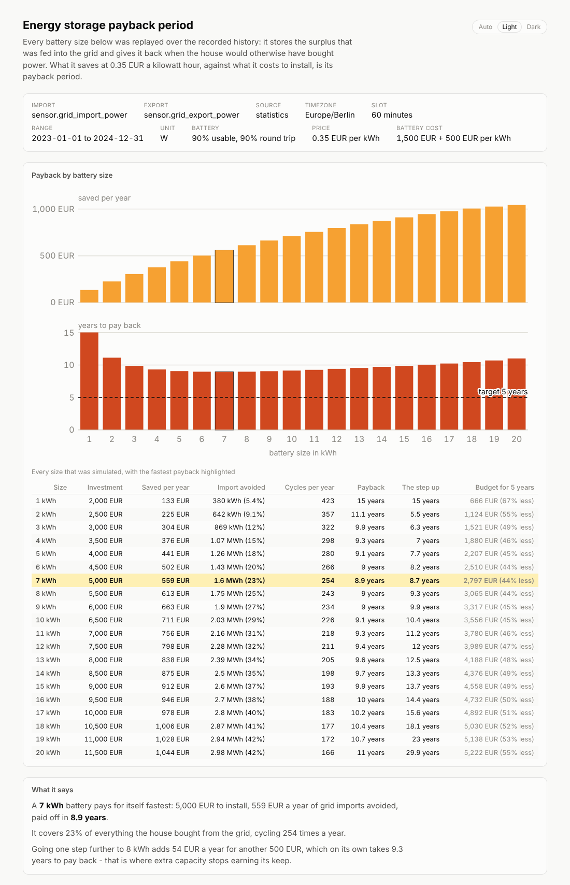

# energy-storage-payback-period

A Home Assistant recorder database usually holds two sensors: the **power drawn from the
grid** and the **power fed back into it**. Everything fed back is given away; everything
drawn is paid for. A battery turns the first into the second - it stores the midday
surplus and returns it in the evening - so its worth is simply the grid import it avoids.

```sh
energy-storage-payback-period --db ha.db \
  --import-entity sensor.grid_import_power \
  --export-entity sensor.grid_export_power \
  --tz Europe/Berlin --price-per-kwh 0.35
```

```
wrote energy-storage-payback-period.html: 20 sizes over 17520 slots of 60 minutes, 25 kB, 43.27ms
measured 14.11 MWh imported and 8.96 MWh exported
best payback: 7 kWh for 5,000 EUR saves 559 EUR a year - paid off in 8.9 years
for 5 years: it would have to cost 2,797 EUR instead of 5,000 EUR (44% less), or 185 EUR per kWh on top of the 1,500 EUR base cost
covers 2023-01-01 to 2024-12-31 (731 days): 731 days paired (730 of them full days), 0 outages over 24 h

open /home/you/energy-storage-payback-period.html
```

The report charts annual savings and payback period against battery size, names the size
that pays back fastest and the point where further capacity stops earning its keep, and
shows what the answer becomes at other electricity prices and other quotes. It also runs
the sum backwards: **how cheap the installation would have to be** to pay back within
`--target-payback-years` (5 by default).



*(From the synthetic [demo database](../../README.md#quick-start), so the prices and the
array are made up - but the arithmetic and the simulation are the real ones.)*

**Both sensors must be power sensors in watts** - the same kind
[`pv-probability`](../pv-probability/README.md) plots. A kilowatt-hour counter has no
`mean` for the recorder to store, and passing one gets the same diagnosis from every tool,
naming the `_power` sensor beside it. `--list-entities` prints what the database holds,
power sensors first.

It is one of the [Home Assistant energy analyzer](../../README.md) tools: see there for
[getting the database](../../README.md#getting-the-database), [finding the right
entity](../../README.md#finding-the-right-entity) and the [options every tool
shares](../../README.md#shared-options).

## How the simulation works

* Each sensor is integrated into energy per slot (`--slot-minutes`, hourly by default,
  which is as fine as a full year of statistics gets). A reading of *w* watts in effect for
  *s* seconds is `w * s / 3 600 000` kWh, so an hourly mean and a chatty `states` history
  give the same answer.
* Only slots **both** sensors really covered are simulated (`--min-slot-coverage`); the
  rest are counted and reported. A battery cannot be sized against a surplus nobody
  recorded.
* Each slot serves the import first and charges from what is left of the export
  afterwards, respecting `--usable-fraction`, `--round-trip` and the optional
  `--max-charge-kw` / `--max-discharge-kw`. Import and export inside one slot are *not*
  netted off: had they been simultaneous the house would never have imported at all.
* Savings are `avoided import x --price-per-kwh`, less `--feed-in-price` for the export the
  battery swallowed - zero by default, because the export is gifted.
* Payback is `(--base-cost + --cost-per-kwh x capacity) / annual savings`. No price
  escalation, no degradation, no discount rate: the sensitivity block shows what moving the
  price or the quote does instead.
* The same sum read backwards gives the **budget**: to pay back within
  `--target-payback-years`, an installation may cost at most `target x annual savings`.
  Each row of the table carries that figure and how far the quote would have to fall to
  meet it; the block below the table works it through for the size that comes closest, and
  says when `--base-cost` alone already exceeds the budget - the case no cell price, not
  even zero, can fix.
* A history shorter than a year is scaled up to one **and** flagged. A summer-heavy
  history flatters a battery; a winter-heavy one does the opposite.
* These sensors show what crossed the meter, not what the house used or the roof made, so
  the report says *grid import avoided* and never claims a self-sufficiency figure.

## Options

| Option | Default | What it does |
|---|---|---|
| `--import-entity <ID>` | required | Power sensor for energy drawn from the grid |
| `--export-entity <ID>` | required | Power sensor for energy fed back |
| `--price-per-kwh <P>` | `0.35` | What a kilowatt hour from the grid costs |
| `--feed-in-price <P>` | `0` | What a kilowatt hour fed back earns |
| `--cost-per-kwh <C>` | `500` | Installed battery cost per kWh of capacity |
| `--base-cost <C>` | `1500` | The part of the bill that does not scale with capacity |
| `--currency <SYMBOL>` | `EUR` | Currency symbol used in the report |
| `--min-size` / `--max-size` / `--size-step` | `1` / `20` / `1` | The sizes to try, in kWh |
| `--sizes <LIST>` | off | Exact sizes instead of the range, e.g. `5,10,13.5` |
| `--round-trip <F>` | `0.9` | Round trip efficiency, charged half on each side |
| `--usable-fraction <F>` | `0.9` | Share of the nameplate actually cycled |
| `--max-charge-kw` / `--max-discharge-kw` | unlimited | Inverter power ceilings |
| `--slot-minutes <M>` | `60` | Simulation slot length; must divide an hour |
| `--min-slot-coverage <F>` | `0.9` | How much of a slot both sensors must have covered |
| `--sensitivity <PCT>` | `25` | How far either side the sensitivity grid looks |
| `--target-payback-years <Y>` | `5` | The payback period the budget is worked back from |
| `--threads <N>` | one per core | Cap the rayon worker threads |
| `-o, --out <FILE>` | `energy-storage-payback-period.html` | Where to write the report |
| `-v` | off | Print row counts, thread count and timings |

Plus the [options every tool shares](../../README.md#shared-options): `--db`,
`--list-entities`, `--source`, `--stat`, `--tz`, `--from` / `--to`, `--max-gap`, `--scale`
and `--gap-threshold-hours`. `--help` prints both lists with the full descriptions.

### Examples

```sh
# Real quotes for the two sizes actually on offer, at next year's price
energy-storage-payback-period --db ha.db \
  --import-entity sensor.grid_import_power --export-entity sensor.grid_export_power \
  --sizes 6.5,13 --base-cost 2200 --cost-per-kwh 430 --price-per-kwh 0.42

# How much does hourly resolution flatter the battery? Check against the last ten days
energy-storage-payback-period --db ha.db \
  --import-entity sensor.grid_import_power --export-entity sensor.grid_export_power \
  --source short-term --slot-minutes 5

# What would it have to cost to be square in three years?
energy-storage-payback-period --db ha.db \
  --import-entity sensor.grid_import_power --export-entity sensor.grid_export_power \
  --target-payback-years 3
```

## Performance

The tool reads its two sensors on two connections at once, folds each into slots
with the same `par_chunks` + `reduce` shape, and then simulates every battery size in
parallel. A battery's state of charge makes one simulation inherently sequential, so the
sizes are the unit of parallelism: 391 sizes over two years of hourly slots take 52 ms on
four cores against 209 ms on one, so a sweep as fine as `--size-step 0.1` costs no more
wall-clock time than a coarse one until it runs out of cores.

