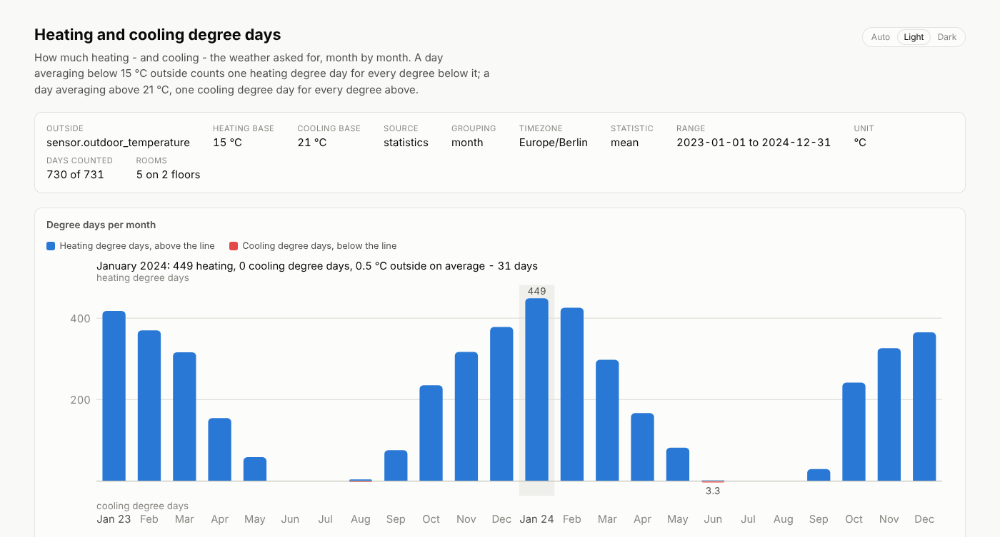

# heating-energy

Degree days measure how much heating - or cooling - the weather demands, so the weather's
effect on a house's energy use can be separated from how efficient the house is.

Pick a **base temperature**: the outside temperature above which the house no longer
needs heating. For each day:

* **Heating degree days** (HDD) = max(0, heating base − daily mean outside temperature)
* **Cooling degree days** (CDD) = max(0, daily mean outside temperature − cooling base)

With a 15 °C base, a day averaging 3 °C counts 12 HDD, and a day averaging 16 °C counts
none. Summed over a month they give the weather's demand for that month - a cold month
might have 450 HDD and a mild one 250 - so a month that used twice the heat with twice the
heating degree days was no less efficient than the other.

`heating-energy` counts them from an outdoor thermometer in a Home Assistant recorder
database, per month or per ISO week and per year, and shows beside them how warm every
room and floor was kept over the same days. Given the energy the heating used each month,
it also works out [what one degree day costs the house](#heating-energy-and-efficiency),
season by season.



*(From the synthetic [demo database](../../README.md#quick-start): a Central European
climate and a two-storey house, made up - but the arithmetic is the real one.)*

It is one of the [Home Assistant energy analyzer](../../README.md) tools: see there for
[getting the database](../../README.md#getting-the-database), [finding the right
entity](../../README.md#finding-the-right-entity) and the [options every tool
shares](../../README.md#shared-options). The name is a compromise: it measures the
cooling side too, but "change-temperature-energy" would not roll off anyone's tongue.

## Running it

```sh
heating-energy --db ha.db --outside-entity sensor.outdoor_temperature \
  --rooms rooms.toml --tz Europe/Berlin
```

```
wrote heating-energy.html: 24 months from 730 days, 30 kB, 24.35ms
degree days: 4,716 heating and 7.4 cooling over 730 days (bases 15 °C and 21 °C)
coldest: January 2024 with 449 heating degree days at 0.5 °C on average
indoors: Ground floor 21.2 °C, First floor 21 °C on the same days
note: 1 day was recorded too thinly to count (under 90% of the day)
covers 2023-01-01 to 2024-12-31 (731 days): 731 days observed (730 of them full days), no outage over 24 h

open /home/you/heating-energy.html
```

The report charts heating degree days above a baseline and cooling degree days below it,
per month or week, with a table of every period beside it: the days counted, the mean
outside temperature, both sums, and each floor's mean indoor temperature. Each floor
opens to its rooms, a table per year follows, and the History block at the foot says
what the thermometer really covered.

`--list-entities` prints the database's thermometers in their own section, after the
power sensors.

## The rooms file

The rooms are far too many pairs for the command line, so they live in a TOML file:
every floor, the rooms on it, and each room's thermometers. `--rooms` is optional - without
it the report covers the outside alone.

```toml
[[floor]]
name = "Ground floor"
rooms = [
  { name = "Living room", sensor = "sensor.living_room_temperature" },
  { name = "Kitchen", sensor = "sensor.kitchen_temperature" },
]

[[floor]]
name = "First floor"
rooms = [
  { name = "Bedroom", sensor = "sensor.bedroom_temperature" },
]
```

A room with more than one thermometer lists them all under `sensors` instead:

```toml
rooms = [
  { name = "Living room", sensors = ["sensor.sofa_temperature", "sensor.desk_temperature"] },
]
```

The room is then their mean: on each day, the plain mean of the thermometers that covered
it, every one counting alike. One that saw too little of a day is left out of that day
rather than counted on a few hours, so such a day stands on the others; the run says on
how many days that happened, and the report says which thermometers make up the room.

[`rooms.example.toml`](rooms.example.toml) is a complete one, matching the demo database.
Floors and rooms appear in the report in the file's order. Room names only have to be
unique on their floor - a bathroom upstairs and one downstairs are fine - but a
thermometer belongs to one room. Mistakes are named rather than guessed around: an
unknown key, a floor without rooms, a room with both `sensor` and `sensors` or neither, a
sensor listed twice, and a sensor that is not a thermometer all stop the run with the
room's name in the message.

### Thermostats with an offset

A thermostat on a radiator measures the air right beside it, which is warmer than the
rest of the room while it heats, so it is often given an offset: set to -2, it reports
two degrees less than it measures, and keeps heating until the far side of the room is
warm enough. Home Assistant records the reading with the offset in it, which is not what
a plain thermometer in the same room would show. The tool takes it back out again, with
nothing to configure:

* **It is found by its id.** A thermostat's reading and its offset setting belong to one
  device, so their ids start with the same device name:
  `sensor.bad_og_heizkorper_temperature` and `number.bad_og_heizkorper_temperature_offset`
  (or `..._local_temperature_calibration`, `..._temperaturversatz`). Every thermometer
  with such a setting beside it is corrected - in a room with several, before they are
  averaged; one that has none, or whose device has two that fit, is left as reported.
* **It is always said.** The run prints by how much each corrected room's readings were
  raised or lowered and which setting that came from, and the report says the same under
  Indoor temperatures.
* **It follows the setting over time.** Every reading has the offset that was set at that
  moment taken out; an hour in which it changed has each value taken out of its part of
  the hour.
* **Only the recent past is on record.** Home Assistant keeps a setting only in its raw
  states - ten days by default - while the thermometer's hourly statistics go back years.
  Readings from before the first recorded value are taken to have had that value too,
  which holds for an offset set once, when the thermostat went in. The run says from when
  the setting is on record.
* **Which way it is applied comes from the readings.** When the offset changed while the
  raw readings were still kept, the reading jumped by the same amount at the same moment:
  up or down shows whether the thermostat adds the offset to what it measures or subtracts
  it, and the run says which it found. Without such a change it is taken to be added, as
  Zigbee and Matter thermostats do.

## Heating energy and efficiency

Give it the energy the heating used each month and it plots every month's kWh against its
heating degree days, and fits a straight line through them:

```sh
heating-energy --db ha.db --outside-entity sensor.outdoor_temperature \
  --energy-entity number.heizol_energy
```

```
efficiency: 2.56 kWh per heating degree day (± 0.10), and 334 kWh a month without heating - a line through 24 months of number.heizol_energy
  2022/23: 2.66 kWh per degree day (± 0.14) over 6 months
  2023/24: 2.62 kWh per degree day (± 0.11) over 12 months, 2% less than 2022/23
  2024/25: 2.17 kWh per degree day (± 0.14) over 6 months, 17% less than 2023/24
```


The **slope** is the house's efficiency figure: the energy one more heating degree day
costs. The weather only moves a month along the line, so insulation, new windows or a
boiler tune-up show as a lower slope however cold the winter was. (The example is the demo
database with a made-up monthly helper added, for a house insulated in the summer of
2024.) Where the line meets zero
degree days is what the house uses **without heating**: hot water, standby losses. The
report shows the months and the line, the slope of every heating season (July to June, so
a winter is never split) as a bar with its standard error, and a table of both.

* **The entity holds each month's energy, in kWh.** It is set on the last day of the
  month to what the heating used that month - not a running total. A value counts for the
  month the day before it was set falls in, so one set just after midnight on the 1st
  still counts for the month that ended; a month given two values keeps the later.
* **Months are matched to whole months of weather.** The energy covers the whole month,
  so a month whose degree days miss a day or two has them scaled up to all its days; one
  missing more than a tenth is left out of the fit, and the run names it.
* **A line needs three months**, milder and colder ones: summer months alone say nothing
  about what heating costs. A season gets a line of its own on the same terms.
* **The ±** is the slope's standard error. Two seasons whose slopes are further apart
  than their errors put together differ by more than the weather's noise.

### Keeping the monthly values

Home Assistant keeps a `number` or `input_number` entity's values only in its raw
states, which it purges after ten days by default - so a helper set once a month has
about one month on record at any time. Two ways to keep them for good:

* Copy the helper into a template sensor with a state class, which Home Assistant keeps
  as long-term statistics for as long as the database lives, and pass that sensor
  instead. Its history starts the day it is created.

  ```yaml
  template:
    - sensor:
        - name: "Heizöl Energie Monat"
          unique_id: heizol_energy_month
          unit_of_measurement: kWh
          device_class: energy
          state_class: total
          availability: "{{ has_value('number.heizol_energy') }}"
          state: "{{ states('number.heizol_energy') | float }}"
  ```

  The availability line matters: without it, a restart that briefly leaves the helper
  unavailable would record a 0 just after a month ended, and the month would read as
  using nothing.

* Or keep raw states longer, with `purge_keep_days` under `recorder:` - for every entity,
  so the database grows with it.

The tool reads long-term statistics where the entity has them and raw states otherwise,
and with `-v` says which. One thing neither keeps: setting a helper to the value it
already has records nothing, so a month that used exactly what the month before did
leaves no trace. Such a month is named in the run and the report, not guessed at.

## How it is counted

* **A day's mean is time-weighted.** Every reading counts for as long as it held, split at
  local midnight in `--tz`, so hourly statistics and a chatty raw `states` history of the
  same weather give the same mean. Days are local calendar days, and a day when the
  clocks change is 23 or 25 hours long.
* **A day counts only when it was recorded.** The outside thermometer has to have covered
  `--min-day-coverage` of it (90% by default): a day whose night is missing reads warm and
  would understate the heating it needed. Days that fall short are left out and
  reported.
* **A period missing days is a floor, not a total.** The sums only add the days that
  counted, and the Days column says "28 of 31" where they fall short - nothing is
  extrapolated. A month or a year at the edge of the record is partial for the same
  reason.
* **Indoor means cover the same days.** A room's figure for a month is the mean of its
  daily means over the month's counted days, wherever its own thermometers covered the day
  too. A room with several thermometers has the mean of those that covered each day, and a
  floor's figure is the plain mean of its rooms: every thermometer counts alike in its
  room, and every room alike on its floor.
* **Units are converted.** A thermometer recorded in °F (or K) is read in °C; the header
  says so. Raw `states` carry no unit of their own, so a °F sensor should be read from its
  statistics, which `--source auto` does anyway.
* **The bases are yours to set.** 15 °C is a usual heating base for a Central European
  house, and 21 °C is the base Eurostat counts cooling degree days from. The right
  heating base is the outside temperature at which *this* house stops needing heat - lower
  the better it is insulated and the cooler it is kept - and the indoor means in the report
  are there to help judge it.

## Options

| Option | Default | What it does |
|---|---|---|
| `--outside-entity <ID>` | required | The outdoor thermometer, e.g. `sensor.outdoor_temperature` |
| `--rooms <FILE>` | none | The [rooms file](#the-rooms-file): floors, rooms and their thermometers |
| `--energy-entity <ID>` | none | [Monthly heating energy](#heating-energy-and-efficiency) in kWh, set on the last day of each month |
| `--heating-base <°C>` | `15` | Outside temperature above which a day needs no heating |
| `--cooling-base <°C>` | `21` | Outside temperature above which a day needs cooling; not below the heating base |
| `--group <month\|week>` | `month` | Sum per calendar month or per ISO week |
| `--min-day-coverage <F>` | `0.9` | How much of a day a thermometer must cover for the day to count |
| `--threads <N>` | one per core | Cap the rayon worker threads |
| `-o, --out <FILE>` | `heating-energy.html` | Where to write the report |
| `-v` | off | Print row counts, thread count and timings |

Plus the [options every tool shares](../../README.md#shared-options): `--db`,
`--list-entities`, `--source`, `--stat`, `--tz`, `--from` / `--to`, `--max-gap`, `--scale`
and `--gap-threshold-hours`. `--help` prints both lists with the full descriptions.

### Examples

```sh
# The outside alone, per ISO week, for the last heating season
heating-energy --db ha.db --outside-entity sensor.outdoor_temperature \
  --group week --from 2025-10-01 --to 2026-04-01

# A well insulated house kept at 20 °C stops heating sooner
heating-energy --db ha.db --outside-entity sensor.outdoor_temperature \
  --rooms rooms.toml --heating-base 12

# The US convention: one base of 65 °F (18.3 °C) for both
heating-energy --db ha.db --outside-entity sensor.outdoor_temperature \
  --heating-base 18.3 --cooling-base 18.3
```

## Performance

Every thermometer is read on a connection of its own, in parallel and itself in time
slices, and its daily means are worked out as soon as it is in. Those are summed in
parallel too, in runs of whole local days, so that every day is still added up in the
order of its readings and comes out the same to the last bit. The summaries per month,
week and year are independent and spread over the cores, with the History block worked
out beside them.

Two years of hourly statistics for the outside and five rooms - 105 000 rows - load,
count and render in about 25 ms on four cores against 67 ms on one.
