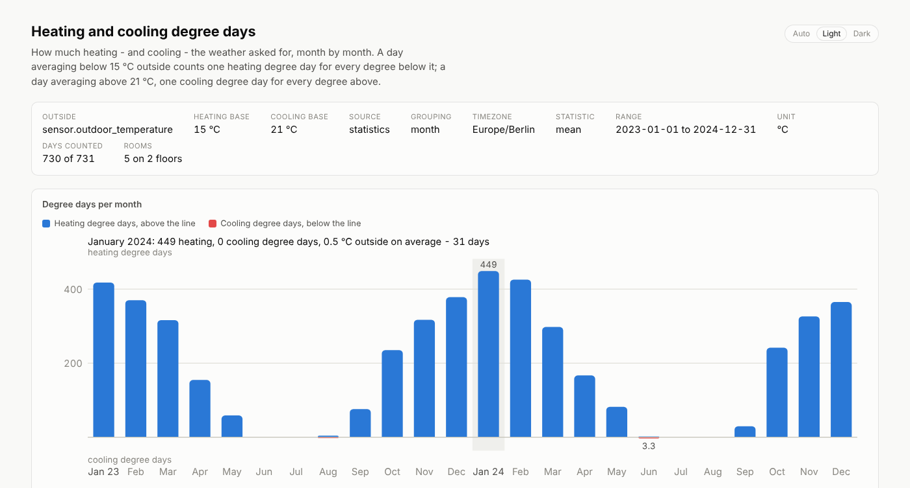

# heating-energy

Degree days measure how much heating - or cooling - the weather demands, so the weather's
effect on a house's energy use can be separated from how efficient the house is.

Pick a **base temperature**: the outside temperature above which the house no longer
needs heating. For each day:

* **Heating degree days** (HDD) = max(0, heating base − daily mean outside temperature)
* **Cooling degree days** (CDD) = max(0, daily mean outside temperature − cooling base)

With a 15 °C base, a day averaging 3 °C counts 12 HDD, and a day averaging 16 °C counts
none. Summed over a month they give the weather's demand for that month - a cold month
might have 450 HDD and a mild one 250 - so a month that used twice the heat with twice the
heating degree days was no less efficient than the other.

`heating-energy` counts them from an outdoor thermometer in a Home Assistant recorder
database, per month or per ISO week and per year, and shows beside them how warm every
room and floor was kept over the same days.



*(From the synthetic [demo database](../../README.md#quick-start): a Central European
climate and a two-storey house, made up - but the arithmetic is the real one.)*

It is one of the [Home Assistant energy analyzer](../../README.md) tools: see there for
[getting the database](../../README.md#getting-the-database), [finding the right
entity](../../README.md#finding-the-right-entity) and the [options every tool
shares](../../README.md#shared-options). The name is a compromise: it measures the
cooling side too, but "change-temperature-energy" would not roll off anyone's tongue.

## Running it

```sh
heating-energy --db ha.db --outside-entity sensor.outdoor_temperature \
  --rooms rooms.toml --tz Europe/Berlin
```

```
wrote heating-energy.html: 24 months from 730 days, 30 kB, 101.11ms
degree days: 4,716 heating and 7.4 cooling over 730 days (bases 15 °C and 21 °C)
coldest: January 2024 with 449 heating degree days at 0.5 °C on average
indoors: Ground floor 21.2 °C, First floor 21 °C on the same days
note: 1 day was recorded too thinly to count (under 90% of the day)
covers 2023-01-01 to 2024-12-31 (731 days): 731 days observed (730 of them full days), no outage over 24 h

open /home/you/heating-energy.html
```

The report charts heating degree days above a baseline and cooling degree days below it,
per month or week, with a table of every period beside it: the days counted, the mean
outside temperature, both sums, and each floor's mean indoor temperature. Each floor
opens to its rooms, a table per year follows, and the History block at the foot says
what the thermometer really covered.

`--list-entities` prints the database's thermometers in their own section, after the
power sensors.

## The rooms file

The rooms are far too many pairs for the command line, so they live in a TOML file:
every floor, the rooms on it, and each room's thermometer. `--rooms` is optional - without
it the report covers the outside alone.

```toml
[[floor]]
name = "Ground floor"
rooms = [
  { name = "Living room", sensor = "sensor.living_room_temperature" },
  { name = "Kitchen", sensor = "sensor.kitchen_temperature" },
]

[[floor]]
name = "First floor"
rooms = [
  { name = "Bedroom", sensor = "sensor.bedroom_temperature" },
]
```

[`rooms.example.toml`](rooms.example.toml) is a complete one, matching the demo database.
Floors and rooms appear in the report in the file's order. Room names only have to be
unique on their floor - a bathroom upstairs and one downstairs are fine - but a
thermometer belongs to one room. Mistakes are named rather than guessed around: an
unknown key, a floor without rooms, a sensor listed twice, and a room whose sensor is not
a thermometer all stop the run with the room's name in the message.

## How it is counted

* **A day's mean is time-weighted.** Every reading counts for as long as it held, split at
  local midnight in `--tz`, so hourly statistics and a chatty raw `states` history of the
  same weather give the same mean. Days are local calendar days, and a day when the
  clocks change is 23 or 25 hours long.
* **A day counts only when it was recorded.** The outside thermometer has to have covered
  `--min-day-coverage` of it (90% by default): a day whose night is missing reads warm and
  would understate the heating it needed. Days that fall short are left out and
  reported.
* **A period missing days is a floor, not a total.** The sums only add the days that
  counted, and the Days column says "28 of 31" where they fall short - nothing is
  extrapolated. A month or a year at the edge of the record is partial for the same
  reason.
* **Indoor means cover the same days.** A room's figure for a month is the mean of its
  daily means over the month's counted days, wherever its own thermometer covered the day
  too. A floor's figure is the plain mean of its rooms, every room counting alike.
* **Units are converted.** A thermometer recorded in °F (or K) is read in °C; the header
  says so. Raw `states` carry no unit of their own, so a °F sensor should be read from its
  statistics, which `--source auto` does anyway.
* **The bases are yours to set.** 15 °C is a usual heating base for a Central European
  house, and 21 °C is the base Eurostat counts cooling degree days from. The right
  heating base is the outside temperature at which *this* house stops needing heat - lower
  the better it is insulated and the cooler it is kept - and the indoor means in the report
  are there to help judge it.

## Options

| Option | Default | What it does |
|---|---|---|
| `--outside-entity <ID>` | required | The outdoor thermometer, e.g. `sensor.outdoor_temperature` |
| `--rooms <FILE>` | none | The [rooms file](#the-rooms-file): floors, rooms and their thermometers |
| `--heating-base <°C>` | `15` | Outside temperature above which a day needs no heating |
| `--cooling-base <°C>` | `21` | Outside temperature above which a day needs cooling; not below the heating base |
| `--group <month\|week>` | `month` | Sum per calendar month or per ISO week |
| `--min-day-coverage <F>` | `0.9` | How much of a day a thermometer must cover for the day to count |
| `--threads <N>` | one per core | Cap the rayon worker threads |
| `-o, --out <FILE>` | `heating-energy.html` | Where to write the report |
| `-v` | off | Print row counts, thread count and timings |

Plus the [options every tool shares](../../README.md#shared-options): `--db`,
`--list-entities`, `--source`, `--stat`, `--tz`, `--from` / `--to`, `--max-gap`, `--scale`
and `--gap-threshold-hours`. `--help` prints both lists with the full descriptions.

### Examples

```sh
# The outside alone, per ISO week, for the last heating season
heating-energy --db ha.db --outside-entity sensor.outdoor_temperature \
  --group week --from 2025-10-01 --to 2026-04-01

# A well insulated house kept at 20 °C stops heating sooner
heating-energy --db ha.db --outside-entity sensor.outdoor_temperature \
  --rooms rooms.toml --heating-base 12

# The US convention: one base of 65 °F (18.3 °C) for both
heating-energy --db ha.db --outside-entity sensor.outdoor_temperature \
  --heating-base 18.3 --cooling-base 18.3
```

## Performance

Every thermometer is read on its own connection in parallel, and each one's daily means
are folded in parallel too; the counting itself is a pass over the days. Two years of
hourly statistics for the outside and five rooms - 105 000 rows - load, count and render
in about 100 ms on four cores.
