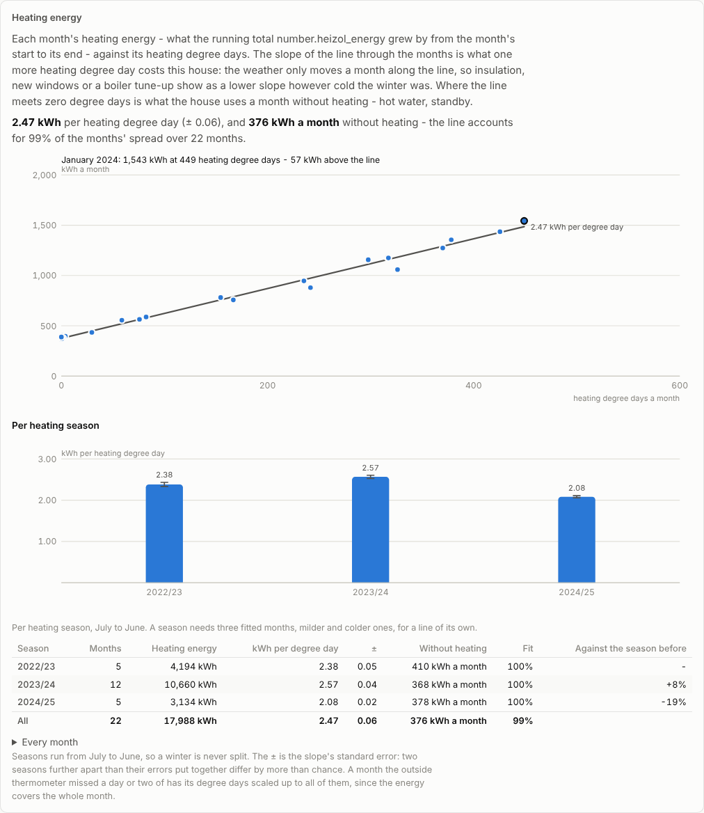
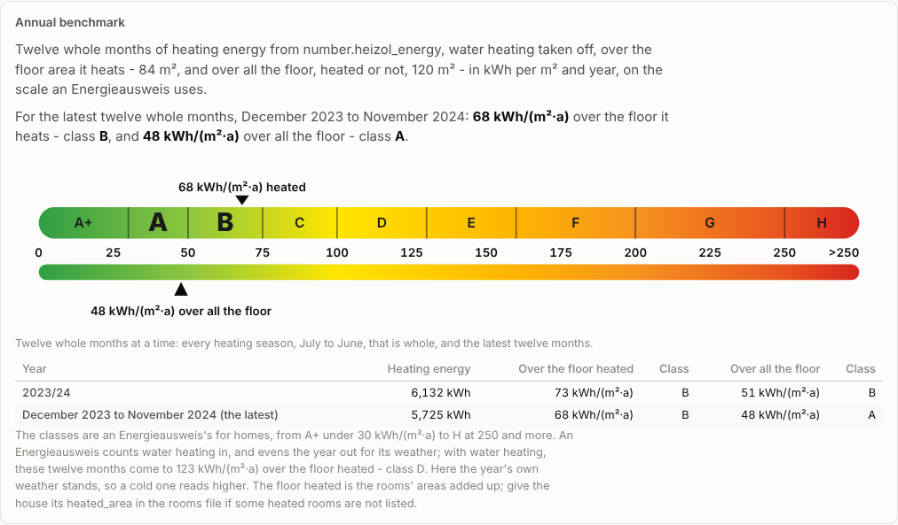

# heating-energy

Degree days measure how much heating - or cooling - the weather demands, so the weather's
effect on a house's energy use can be separated from how efficient the house is.

Pick a **base temperature**: the outside temperature above which the house no longer
needs heating. For each day:

* **Heating degree days** (HDD) = max(0, heating base − daily mean outside temperature)
* **Cooling degree days** (CDD) = max(0, daily mean outside temperature − cooling base)

With a 15 °C base, a day averaging 3 °C counts 12 HDD, and a day averaging 16 °C counts
none. Summed over a month they give the weather's demand for that month - a cold month
might have 450 HDD and a mild one 250 - so a month that used twice the heat with twice the
heating degree days was no less efficient than the other.

`heating-energy` counts them from an outdoor thermometer in a Home Assistant recorder
database, per month or per ISO week and per year, and shows beside them how warm every
room and floor was kept over the same days. Given the heating's energy as a running total,
it also works out [what one degree day costs the house](#heating-energy-and-efficiency),
season by season.


*(From the synthetic [demo database](../../README.md#quick-start): a Central European
climate and a two-storey house, made up - but the arithmetic is the real one.)*

It is one of the [Home Assistant energy analyzer](../../README.md) tools: see there for
[getting the database](../../README.md#getting-the-database), [finding the right
entity](../../README.md#finding-the-right-entity) and the [options every tool
shares](../../README.md#shared-options). The name is a compromise: it measures the
cooling side too, but "change-temperature-energy" would not roll off anyone's tongue.

## Running it

```sh
heating-energy --db ha.db --outside-entity sensor.outdoor_temperature \
  --rooms rooms.toml --tz Europe/Berlin
```

```
wrote heating-energy.html: 24 months from 730 days, 32 kB, 22.04ms
degree days: 4,716 heating and 7.4 cooling over 730 days (bases 15 °C and 21 °C)
coldest: January 2024 with 449 heating degree days at 0.5 °C on average
indoors: Ground floor 21.2 °C, First floor 21 °C on the same days
note: 1 day was recorded too thinly to count (under 90% of the day)
note: What a degree day costs, Building or behaviour, A degree warmer and Annual benchmark wait for data - --energy-entity; the report says what each needs
covers 2023-01-01 to 2024-12-31 (731 days): 731 days observed (730 of them full days), no outage over 24 h

open /home/you/heating-energy.html
```

The report charts heating degree days above a baseline and cooling degree days below it,
per month or week, with a table of every period beside it: the days counted, the mean
outside temperature, both sums, and each floor's mean indoor temperature. Each floor
opens to its rooms, a table per year follows, and the History block at the foot says
what the thermometer really covered.

Every section of the report is always there. One the run was not given enough for keeps
its heading and says what it would show, what it needs and where this README tells of it,
and the run names them all in one note:

| Section | Needs |
|---|---|
| Degree days, Per year, How it is counted | `--outside-entity` |
| [What a degree day costs](#heating-energy-and-efficiency) | `--energy-entity` |
| [Building or behaviour](#building-or-behaviour-the-heat-loss-coefficient), [A degree warmer](#a-degree-warmer) | `--energy-entity`, and `--rooms` with every room's `area` |
| [Annual benchmark](#annual-benchmark) | `--energy-entity`, and `--rooms` with every room's `area` or the house's `heated_area` |
| [Indoor temperatures](#the-rooms-file) | `--rooms` |

`--list-entities` prints the database's thermometers in their own section, after the
power sensors.

## The rooms file

The rooms are far too many pairs for the command line, so they live in a TOML file:
every floor, the rooms on it, and each room's thermometers. `--rooms` is optional - without
it the report covers the outside alone.

```toml
[[floor]]
name = "Ground floor"
rooms = [
  { name = "Living room", sensor = "sensor.living_room_temperature" },
  { name = "Kitchen", sensor = "sensor.kitchen_temperature" },
]

[[floor]]
name = "First floor"
rooms = [
  { name = "Bedroom", sensor = "sensor.bedroom_temperature" },
]
```

A room with more than one thermometer lists them all under `sensors` instead:

```toml
rooms = [
  { name = "Living room", sensors = ["sensor.sofa_temperature", "sensor.desk_temperature"] },
]
```

The room is then their mean: on each day, the plain mean of the thermometers that covered
it, every one counting alike. One that saw too little of a day is left out of that day
rather than counted on a few hours, so such a day stands on the others; the run says on
how many days that happened, and the report says which thermometers make up the room.

A room may give its floor area in square metres. Together with the
[heating energy](#heating-energy-and-efficiency), the rooms' temperatures weighted by it
make the house's temperature, which [the heat loss coefficient](#building-or-behaviour-the-heat-loss-coefficient)
is worked out from; nothing else uses it:

```toml
rooms = [
  { name = "Living room", sensor = "sensor.living_room_temperature", area = 32.5 },
]
```

The [annual benchmark](#annual-benchmark) sets a year's heating energy against the floor
area it heats - the rooms' areas added up - and against all the floor, heated or not. A
`[house]` table gives the latter, and the former too where some heated rooms have no
thermometer and so are not listed:

```toml
[house]
heated_area = 140   # optional: the rooms' areas added up otherwise
total_area = 190    # all the floor, heated or not
```

[`rooms.example.toml`](rooms.example.toml) is a complete one, matching the demo database.
Floors and rooms appear in the report in the file's order. Room names only have to be
unique on their floor - a bathroom upstairs and one downstairs are fine - but a
thermometer belongs to one room. Mistakes are named rather than guessed around: an
unknown key, a floor without rooms, a room with both `sensor` and `sensors` or neither, a
sensor listed twice, an area of nothing or less, and a sensor that is not a thermometer
all stop the run with the room's name in the message - as does a house whose
`total_area` is less than the floor it heats.

### Thermostats with an offset

A thermostat on a radiator measures the air right beside it, which is warmer than the
rest of the room while it heats, so it is often given an offset: set to -2, it reports
two degrees less than it measures, and keeps heating until the far side of the room is
warm enough. Home Assistant records the reading with the offset in it, which is not what
a plain thermometer in the same room would show. The tool takes it back out again, with
nothing to configure:

* **It is found by its id.** A thermostat's reading and its offset setting belong to one
  device, so their ids start with the same device name:
  `sensor.bad_og_heizkorper_temperature` and `number.bad_og_heizkorper_temperature_offset`
  (or `..._local_temperature_calibration`, `..._temperaturversatz`). Every thermometer
  with such a setting beside it is corrected - in a room with several, before they are
  averaged; one that has none, or whose device has two that fit, is left as reported.
* **It is always said.** The run prints by how much each corrected room's readings were
  raised or lowered and which setting that came from, and the report says the same under
  Indoor temperatures.
* **It follows the setting over time.** Every reading has the offset that was set at that
  moment taken out; an hour in which it changed has each value taken out of its part of
  the hour.
* **Only the recent past is on record.** Home Assistant keeps a setting only in its raw
  states - ten days by default - while the thermometer's hourly statistics go back years.
  Readings from before the first recorded value are taken to have had that value too,
  which holds for an offset set once, when the thermostat went in. The run says from when
  the setting is on record.
* **Which way it is applied comes from the readings.** When the offset changed while the
  raw readings were still kept, the reading jumped by the same amount at the same moment:
  up or down shows whether the thermostat adds the offset to what it measures or subtracts
  it, and the run says which it found. Without such a change it is taken to be added, as
  Zigbee and Matter thermostats do.

## Heating energy and efficiency

Give it the heating's energy as a running total - a meter in kWh, read on the last day of
every month, and as often between as you like - and it takes what the total grew by over
every month, takes off what heating water took, plots the rest against the month's heating
degree days, and fits a straight line through them:

```sh
heating-energy --db ha.db --outside-entity sensor.outdoor_temperature \
  --energy-entity number.heizol_energy
```

```
efficiency: 2.50 kWh per heating degree day (± 0.06), once water heating of 389 kWh a month on average is taken off - a line through 22 months of number.heizol_energy
  2022/23: 2.43 kWh per degree day (± 0.01) over 5 months; water heating 379 kWh a month, 2023/24's
  2023/24: 2.57 kWh per degree day (± 0.03) over 12 months, 6% more than 2022/23; water heating 379 kWh a month, from July 2023, August 2023 and June 2024
  2024/25: 2.10 kWh per degree day (± 0.03) over 5 months, 18% less than 2023/24; water heating 399 kWh a month, from July 2024, August 2024 and September 2024
```



The **slope** is the house's efficiency figure: the energy one more heating degree day
costs. The weather only moves a month along the line, so insulation, new windows or a
boiler tune-up show as a lower slope however cold the winter was. (The example is the demo
database with a made-up meter added, for a house insulated in the summer of 2024.) The
report shows the months and the line, the slope of every heating season (July to June, so
a winter is never split) as a bar with its standard error, and a table of both with every
season's water heating.

* **A month's energy is the total at its end less the total at its start**, both taken at
  local midnight as the month turns. Readings in between change nothing, so reading the
  meter every two weeks gives the same months as reading it monthly. A value repeated
  unchanged - at a restart - is no new reading.
* **A reading on the 1st still closes the month before** when the meter was not read on
  its last day, and a value brought down on the 1st puts right the one before it. So a
  month counts once the 1st after it is over.
* **Water heating is taken off first.** It does not follow the weather, so it would only
  blur the line: what a season's three warmest months from May to September - by the
  outside thermometer - used a day, with the heating off, is taken off every day of that
  season, and the line goes through the heating energy left. A meter for heating alone
  shows next to nothing in summer, so next to nothing is taken off. A season with fewer than three such months on record - the
  first, starting in January, or the current one before September is over - takes the
  nearest season's. With none anywhere, water heating stays in, and the run says so and
  gives what the line's base holds: what the house uses a month without heating.
* **A month needs its weather.** One the outside thermometer missed a day or two of has
  its degree days scaled up to the whole month, since the energy covers all of it; one
  missing more than a tenth is left out.
* **A month the total did not change over is left out, and so is the month after it**: a
  reading missed at the end of July leaves July at nothing and August holding both. One
  over which the total went down - a meter replaced, a reading put right late - is left
  out too. The run names them all.
* **A line needs three months**, milder and colder ones: summer alone says nothing about
  what heating costs. A season gets a line of its own on the same terms.
* **The ±** is the slope's standard error. Two seasons whose slopes are further apart
  than their errors put together differ by more than the weather's noise.

### Building or behaviour: the heat loss coefficient

Degree days take the house to be kept at one temperature, so kWh per degree day moves
with how warm it is kept as well as with the building. Give the rooms in the rooms file
their floor area, and the run also works out what the building alone loses:

```sh
heating-energy --db ha.db --outside-entity sensor.outdoor_temperature \
  --energy-entity number.heizol_energy --rooms rooms.toml
```

With the demo's rooms, as [`rooms.example.toml`](rooms.example.toml) gives their areas, and
the made-up meter, whose house was insulated in the summer of 2024:

```
heat loss: 108 W/K over 16 heating months, the house kept at 20.5 °C - its 5 rooms weighted by 84 m² of floor; the sun and the household gave about 635 W for free
  2022/23: 107 W/K at 20.5 °C over 4 months
  2023/24: 111 W/K at 20.5 °C over 9 months; against 2022/23: kWh per degree day +6%, heat loss +3%, the house 0.1 K cooler - the building and how warm the house was kept alike
  2024/25: 89 W/K at 20.7 °C over 3 months; against 2023/24: kWh per degree day -18%, heat loss -19%, the house 0.2 K warmer - mostly the building
```

* **The house's temperature** is the rooms', weighted by their floor area: Σ(area ×
  temperature) / total area, hour by hour. An hour any room with an area - or the outside
  thermometer - is missing from is left out rather than read from the others alone; a
  room without an area is left out of it altogether, and the run names it.
* **Degree-hours** add up the house's temperature less the outside's, hour by hour, over
  a month - scaled up to the whole month where a few hours are missing, as degree days
  are; a month missing more than a tenth is left out.
* **The heat loss coefficient** is the slope of a straight line through the heating
  months' heating energy - water heating taken off - against their degree-hours, times a
  thousand: watts for every kelvin the house is kept above the outside. The sun and the
  household give heat for free as well, about the same every month; it only moves the
  line down, and where the line meets no degree-hours, below nothing, it says how much
  that was. Heating energy over degree-hours alone would count the free heat as heat the
  building did not lose, and read lower the milder the months - on the demo, 79 W/K in
  January and 49 W/K in April for the same house. Only the heating months count, those
  colder on average than the heating base: in milder ones the heating is off or nearly
  so, and the line would bend there. A season needs three of them, milder and colder
  ones, for a line of its own.
* **What changed** sets each season against the one before. kWh per degree day moves with
  both the building and how warm the house is kept; the heat loss coefficient with the
  building alone. When two thirds or more of the change in kWh per degree day is the heat
  loss coefficient's, it was mostly the building; a third or less, mostly how warm the
  house was kept. A change in kWh per degree day under 3% is none.

The report shows the same under What a degree day costs, with the house's temperature and
degree-hours of every month in the month table, and whether it is one of the heating
months the line runs through.

### A degree warmer

From the same hours, the run works out what keeping the house a degree warmer costs, and
the report gives it a section of its own - the rule of thumb says about 6% more heating
energy, and the house's own number is more convincing:

```
a degree warmer: 713 kWh more heating energy in a season like 2023/24, with its 9 heating months: 11.6% of its heating energy - the rule of thumb says 6%; each degree-hour costs 108 Wh
  2022/23: 309 kWh over 4 heating months, 13.2% of its heating energy
  2023/24: 729 kWh over 9 heating months, 11.9% of its heating energy
  2024/25: 195 kWh over 3 heating months, 17.0% of its heating energy
```

* **A degree warmer adds a degree-hour to every hour** of the heating months, and the
  heating has to make up all of it: the sun and the household give no more for it. What
  one more degree-hour costs is the heat loss coefficient above - 108 W/K on the demo is
  108 Wh every hour for every degree.
* **A season's cost** is that times the hours of its heating months, and its share is of
  the season's heating energy. The headline takes the coefficient from every heating month
  on record, applied to the season with the most heating months; the table gives every
  season's own.
* **It is if anything a little more**: a warmer house would also want heating on a few
  more days at either end of the season, which the heating months leave out.

### Annual benchmark

Twelve whole months of heating energy - water heating taken off - over the floor area,
in kWh per m² and year, on the scale an Energieausweis uses:

```
benchmark: 68 kWh/(m²·a) over the 84 m² heated, class B, and 48 kWh/(m²·a) over all 120 m², class A - the latest twelve whole months, December 2023 to November 2024
  2023/24: 73 kWh/(m²·a) over the 84 m² heated, class B, and 51 kWh/(m²·a) over all 120 m², class B
```



* **A year** is twelve whole months in a row whose energy is sound - none left out for a
  missed reading or a total that went down. The headline and the scale take the latest
  such twelve months; the table gives every whole heating season, July to June, beside
  them.
* **Two floor areas**: the floor the heating heats - the rooms' areas added up, or the
  house's `heated_area` - marked above the scale, and all the floor, heated or not, the
  house's `total_area`, marked below it. Without `total_area` there is only the first.
* **The classes** are the Energieausweis's for homes: A+ under 30 kWh/(m²·a), A under 50,
  B under 75, C under 100, D under 130, E under 160, F under 200, G under 250, H from 250.
  An Energieausweis counts water heating in, and evens the year out for its weather; the
  report gives the figure with water heating too, but leaves the year's own weather
  standing, so a cold year reads higher.

### Keeping the readings

A sensor with a state class - `total_increasing` for a meter - is kept by Home Assistant
as long-term statistics for as long as the database lives, and the tool reads them. A
plain `number` or `input_number` helper has no statistics: its values live only in the
raw states, purged after ten days by default. Copy such a helper into a template sensor
and pass that instead:

```yaml
template:
  - sensor:
      - name: "Heizöl Energie"
        unique_id: heizol_energy_total
        unit_of_measurement: kWh
        device_class: energy
        state_class: total_increasing
        availability: "{{ has_value('input_number.heizol_energy') }}"
        state: "{{ states('input_number.heizol_energy') | float }}"
```

The availability line matters: without it, a restart that briefly leaves the helper
unavailable records a 0, and a month that happens to end on it reads as gone down. With `-v` the run says whether it read statistics or raw states, and how many
readings it found. Its units may be kWh, Wh or MWh.

## How it is counted

* **A day's mean is time-weighted.** Every reading counts for as long as it held, split at
  local midnight in `--tz`, so hourly statistics and a chatty raw `states` history of the
  same weather give the same mean. Days are local calendar days, and a day when the
  clocks change is 23 or 25 hours long.
* **A day counts only when it was recorded.** The outside thermometer has to have covered
  `--min-day-coverage` of it (90% by default): a day whose night is missing reads warm and
  would understate the heating it needed. Days that fall short are left out and
  reported.
* **A period missing days is a floor, not a total.** The sums only add the days that
  counted, and the Days column says "28 of 31" where they fall short - nothing is
  extrapolated. A month or a year at the edge of the record is partial for the same
  reason.
* **Indoor means cover the same days.** A room's figure for a month is the mean of its
  daily means over the month's counted days, wherever its own thermometers covered the day
  too. A room with several thermometers has the mean of those that covered each day, and a
  floor's figure is the plain mean of its rooms: every thermometer counts alike in its
  room, and every room alike on its floor.
* **Units are converted.** A thermometer recorded in °F (or K) is read in °C; the header
  says so. Raw `states` carry no unit of their own, so a °F sensor should be read from its
  statistics, which `--source auto` does anyway.
* **The bases are yours to set.** 15 °C is a usual heating base for a Central European
  house, and 21 °C is the base Eurostat counts cooling degree days from. The right
  heating base is the outside temperature at which *this* house stops needing heat - lower
  the better it is insulated and the cooler it is kept - and the indoor means in the report
  are there to help judge it.

## Options

| Option | Default | What it does |
|---|---|---|
| `--outside-entity <ID>` | required | The outdoor thermometer, e.g. `sensor.outdoor_temperature` |
| `--rooms <FILE>` | none | The [rooms file](#the-rooms-file): floors, rooms, their thermometers and floor areas |
| `--energy-entity <ID>` | none | The [heating's energy as a running total](#heating-energy-and-efficiency) in kWh, read on the last day of every month |
| `--heating-base <°C>` | `15` | Outside temperature above which a day needs no heating |
| `--cooling-base <°C>` | `21` | Outside temperature above which a day needs cooling; not below the heating base |
| `--group <month\|week>` | `month` | Sum per calendar month or per ISO week |
| `--min-day-coverage <F>` | `0.9` | How much of a day a thermometer must cover for the day to count |
| `--threads <N>` | one per core | Cap the rayon worker threads |
| `-o, --out <FILE>` | `heating-energy.html` | Where to write the report |
| `-v` | off | Print row counts, thread count and timings |

Plus the [options every tool shares](../../README.md#shared-options): `--db`,
`--list-entities`, `--source`, `--stat`, `--tz`, `--from` / `--to`, `--max-gap`, `--scale`
and `--gap-threshold-hours`. `--help` prints both lists with the full descriptions.

### Examples

```sh
# The outside alone, per ISO week, for the last heating season
heating-energy --db ha.db --outside-entity sensor.outdoor_temperature \
  --group week --from 2025-10-01 --to 2026-04-01

# A well insulated house kept at 20 °C stops heating sooner
heating-energy --db ha.db --outside-entity sensor.outdoor_temperature \
  --rooms rooms.toml --heating-base 12

# The US convention: one base of 65 °F (18.3 °C) for both
heating-energy --db ha.db --outside-entity sensor.outdoor_temperature \
  --heating-base 18.3 --cooling-base 18.3
```

## Performance

Every thermometer is read on a connection of its own, in parallel and itself in time
slices, and its daily means are worked out as soon as it is in. Those are summed in
parallel too, in runs of whole local days, so that every day is still added up in the
order of its readings and comes out the same to the last bit. The summaries per month,
week and year are independent and spread over the cores, with the History block worked
out beside them.

Two years of hourly statistics for the outside and five rooms - 105 000 rows - load,
count and render in about 25 ms on four cores against 67 ms on one.
