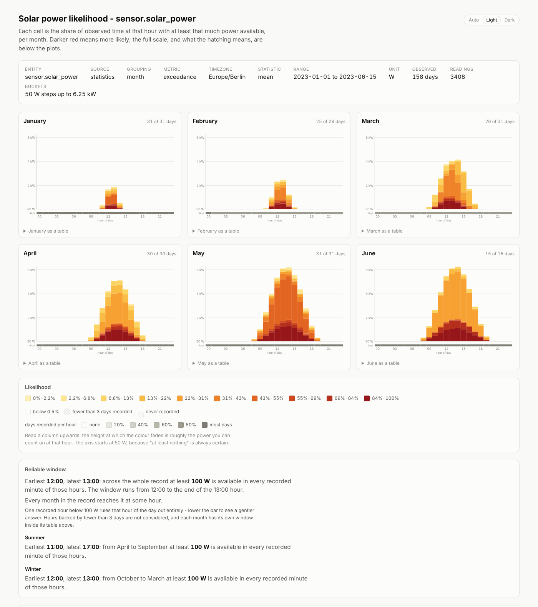
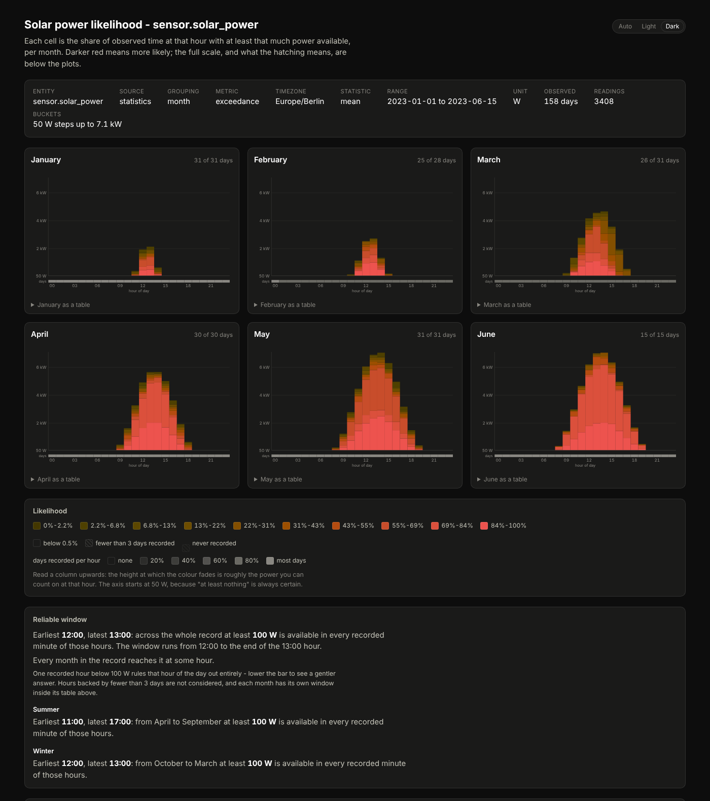

# pv-probability

Turn a Home Assistant recorder database into "flame graph" heatmaps of how much solar
power you can actually count on, hour by hour, month by month.

One heatmap per month (or per ISO week). The x-axis is the hour of the day, the y-axis is
power in configurable 50 W steps, and each cell answers a single question:

> **How often, historically, was at least this much power available at this hour?**

Very likely is deep red, unlikely fades to yellow, and never blank. Read a column upwards
and the height at which the colour fades is roughly the load you can start at that hour.



The report is one self-contained HTML file: no JavaScript, no web fonts, no network
access. It follows your system's light/dark setting - with an Auto / Light / Dark switch in
the header to override it - reads out the exact figure above the plot as you hover a cell,
and carries a table view of the same numbers under each plot. Under the colour key it
answers the scheduling question directly: [the earliest and latest hour you can count
on](#the-reliable-window).



*(The screenshots come from the synthetic `spotty` [demo
database](../../README.md#quick-start) - half a year of history with outages in it - not
from real production data. The grey strip under each plot and the "History" block at the
foot of the page are what that partial history looks like; see [Partial history and
outages](#partial-history-and-outages).)*

It is one of the [Home Assistant energy analyzer](../../README.md) tools: see there for
[getting the database](../../README.md#getting-the-database), [finding the right
entity](../../README.md#finding-the-right-entity) and the [options every tool
shares](../../README.md#shared-options).

## Running it

```sh
pv-probability --db ha.db --entity sensor.solar_power --tz Europe/Berlin
```

It finishes by printing the command that opens the report, ready to paste:

```
wrote pv-probability.html: 12 facets from 17520 readings (730 d), 340 kB, 9.70ms
reliable window: 12:00 to the end of the 13:00 hour - at least 100 W in every recorded minute
  summer (April to September): 11:00 to the end of the 16:00 hour - at least 100 W in every recorded minute
  winter (October to March): 12:00 to the end of the 13:00 hour - at least 100 W in every recorded minute
covers 2023-01-01 to 2024-12-31 (731 days): 731 days observed (730 of them full days), no outage over 24 h

open /home/you/pv-probability.html
```

## Partial history and outages

This is written for a real recorder database, which is rarely a tidy block of years. Less
than a year of history, and holes in the middle of it, are the normal case.

**What the tool does about it**

* **Months you have no data for are simply absent** from the report - not drawn empty, not
  guessed at. The header names any that are missing from a span that could have contained
  them.
* **Evidence is counted in distinct local days, never in readings.** One sunny morning can
  be six readings from the hourly statistics table or six hundred from `states`; it is one
  day of evidence either way. Any (month, hour) column backed by fewer than `--min-days`
  days (default 3) is **hatched rather than coloured**, so a single February morning cannot
  masquerade as a settled 100%.
* **Hours the recorder never covered are hatched differently** from hours it covered only
  briefly, so "we know nothing about 03:00" is distinguishable from "we have two days of
  03:00".
* **A coverage strip under every heatmap** shows, hour by hour, how many distinct days back
  that column, shaded on a neutral grey scale and exact on hover. The panel caption states
  the same thing for the month as a whole ("26 of 31 days").
* **The header reports the real span and the outages in it**: how many days carry data, how
  many were recorded right through the day, how many outages longer than
  `--gap-threshold-hours` (default 24) interrupted it, and how long the worst one was. The
  same summary goes to stdout, with every outage listed under `-v`.

**What it cannot do about it**

Every percentage is conditional on the time that was actually recorded. If the recorder was
down through a sunny week in July, that week is not represented at all, and July's numbers
describe the days that survived rather than July. No amount of arithmetic fixes that; the
coverage strip and the outage summary are there so you can see when it applies.

Two knobs are worth knowing:

* `--min-days 1` shows everything, however thin. `--min-days 10` is strict.
* `--gap-threshold-hours 6` catches shorter outages. The default of 24 exists because many
  inverters report `unavailable` all night, and a 14 hour nightly hole would otherwise fill
  the report with "outages". If your sensor reports 0 W at night instead, lower it.

## How the numbers are computed

* **Time-weighted, not row-weighted.** Every reading is weighted by how long it was in
  effect, so a sensor that reports rapidly at noon and rarely at dusk does not skew the
  result. Raw states are carried forward until the next reading, capped at `--max-gap`
  (default 15 minutes) so a recorder outage is not counted as hours of steady production.
  A statistics row counts as its hour, a short-term row as its five minutes.
* **Split at local hour boundaries.** A reading in effect from 13:50 to 14:20 contributes
  10 minutes to hour 13 and 20 minutes to hour 14.
* **Daylight saving is handled honestly.** Hours are local wall-clock hours in `--tz`. On
  the spring-forward day the missing local hour gets no weight; on the fall-back day the
  repeated hour gets both passes. That is what you want when the question is "at 14:00,
  what can I run?".
* **Exceedance by default.** Cell = `P(watts >= the bucket's lower edge)`, computed as a
  reverse cumulative sum over the power axis and normalised by the observed time of that
  hour. This is what gives the plot its flame shape. `--metric density` switches to
  `P(watts inside the bucket)` instead, where each column sums to 100%.
* **The exceedance axis starts one step up.** "At least 0 W" is true whenever the hour was
  observed at all, so drawing it would paint a certainty band across the night.
* **Thin columns are marked, not guessed.** Evidence is counted in distinct local days, so
  an hour backed by fewer than `--min-days` of them is hatched rather than coloured however
  many rows the recorder wrote. See [Partial history and outages](#partial-history-and-outages).
* **Facets pool across years.** Every June in the database contributes to the June
  heatmap; that is the point of asking about likelihood. Narrow the window with `--from` /
  `--to` if you want a single season.

## The reliable window

The heatmaps show what is *likely*; a load schedule needs to know what is *safe*. The
**Reliable window** block, between the colour key and the History section, names the
earliest and the latest hour of the day that reach a given power - by default 100 W - in
every recorded minute:

```
Earliest 12:00, latest 13:00: across the whole record at least 100 W is available in
every recorded minute of those hours. The window runs from 12:00 to the end of the
13:00 hour.
```

Below it, **Summer** and **Winter** answer the same question for each half of the year,
pooled the same way over only their months, in one sentence each:

```
Summer
Earliest 11:00, latest 16:00: from April to September at least 100 W is available in
every recorded minute of those hours.

Winter
Earliest 12:00, latest 13:00: from October to March at least 100 W is available in
every recorded minute of those hours.
```

The whole record can only promise what its worst month promises, so its window is
usually winter's; the summer line says how much more the long days allow. The halves are
whole calendar months under `--group week` too, pooled from the readings themselves,
since ISO weeks straddle the month boundaries. A half the recorder never covered says so
instead.

The same sentence appears for each individual month or week, at the top of that panel's
expandable table, so "when can I run this in November?" is answered in the panel itself.
The lines printed after a run carry the overall and the seasonal figures too.

* `--reliable-watts <W>` sets the power. It is rounded **up** to a bucket edge - asking
  for 120 W with 50 W steps is answered from the "at least 150 W" row, never from the
  100 W one, which would overstate the claim - and the block says so when it rounds.
* `--reliable-probability <P>` sets how strict "always" is. At the default of `1` a
  single recorded hour below the threshold rules that hour of the day out for good, which
  on a patchy history often leaves no window at all. That is the honest answer, and the
  report says it in words rather than showing an empty range; `--reliable-probability 0.9`
  then asks the useful follow-up question.
* Hours the `--min-days` rule considers too thin never qualify: two sunny mornings are not
  a guarantee.
* The overall figure pools every month, weighted by how much of each was actually
  recorded. At `--reliable-probability 1` that is exactly the intersection of the monthly
  windows, so the whole record can only promise what its worst month promises - and when
  the months clear the bar at different hours, the pooled window can be empty while no
  single month is. The block explains that where it happens.

## Options

```
pv-probability --db <FILE> --entity <ENTITY_ID> [OPTIONS]
```

| Option | Default | What it does |
|---|---|---|
| `--entity <ID>` | required | `sensor.solar_power`; also accepted as a `statistic_id` |
| `--group <month\|week>` | `month` | One heatmap per calendar month or per ISO week |
| `--step-watts <W>` | `50` | Height of one power bucket |
| `--max-watts <W>` | auto | Top of the power axis; everything above lands in the top bucket |
| `--max-quantile <Q>` | `0.999` | Quantile used to pick the axis when `--max-watts` is absent |
| `--metric <exceedance\|density>` | `exceedance` | Cell meaning |
| `--min-days <N>` | `3` | Hours backed by fewer distinct days are hatched, not coloured |
| `--reliable-watts <W>` | `100` | Power the [reliable window](#the-reliable-window) asks about |
| `--reliable-probability <P>` | `1` | Share of recorded time that has to reach it; `1` means always |
| `--min-probability <P>` | `0.005` | Cells below this are left blank |
| `--gamma <G>` | `0.6` | Ramp shaping; below 1 lifts rare-but-real cells into view |
| `--levels <N>` | `10` | Colour steps on the likelihood scale (3-16) |
| `--keep-negative` | off | Keep negative readings instead of clamping them to zero |
| `--threads <N>` | one per core | Cap the rayon worker threads |
| `-o, --out <FILE>` | `pv-probability.html` | Where to write the report |
| `-v` | off | Print row counts and timings |

Plus the [options every tool shares](../../README.md#shared-options): `--db`,
`--list-entities`, `--source`, `--stat`, `--tz`, `--from` / `--to`, `--max-gap`, `--scale`
and `--gap-threshold-hours`. `--help` prints both lists with the full descriptions.

### Examples

```sh
# Weekly resolution, 100 W buckets, only last year
pv-probability --db ha.db --entity sensor.solar_power --group week \
  --step-watts 100 --from 2025-01-01 --to 2026-01-01 --tz Europe/Berlin

# What is the peak within each hour, rather than the hourly average?
pv-probability --db ha.db --entity sensor.solar_power --stat max

# High-resolution look at the last ten days from the raw states table
pv-probability --db ha.db --entity sensor.solar_power --source states --group week

# A sensor that reports kilowatts but has no unit recorded
pv-probability --db ha.db --entity sensor.pv_now --scale 1000

# When can I count on 500 W nine days out of ten?
pv-probability --db ha.db --entity sensor.solar_power \
  --reliable-watts 500 --reliable-probability 0.9
```

## Colour scale

The ramp is a semantic heat scale, monotone in perceived lightness so it survives
greyscale printing and colour vision deficiencies: light mode runs pale yellow to deep
red (OKLCH lightness 0.95 down to 0.43), dark mode runs dim ochre to bright red (0.34 up
to 0.65). In both themes "unlikely" recedes towards the page and "likely" stands out. The
legend spells out the probability range of every step, and the table view under each plot
gives the same numbers as text.

## Performance

Every stage runs on all cores. The history is read in time slices, each on a connection
of its own. Every sample is placed on the local calendar in parallel - cut at the hour
boundaries, each piece given its month or week, hour and day - and the pieces are then
added into one histogram in a single pass. The power axis quantile uses a parallel sort,
the History block is worked out beside the probabilities, a report by week folds the
month grid behind the summer and winter windows beside its own, and the facets are
rendered concurrently.

Two years of hourly statistics (17 520 rows, 147 buckets) load, aggregate and render in
about 8 ms on four cores against 15 ms on one; by week, with 53 heatmaps to draw, in about
17 ms. The work scales linearly, so even a five-minute-resolution decade stays
interactive. `--threads` caps the pool if you want to leave cores free.
